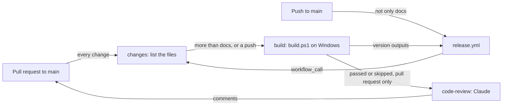

# CI

How [`.github/workflows/ci.yml`](../.github/workflows/ci.yml) builds, tests and reviews each pull request (PR), and checks each push to `main` and works out its version for the release workflow. It's for engineers changing the workflow, the build or the code review.

## Contents

1. [Overview](#overview)
1. [The build](#the-build)
1. [Code review](#code-review)
1. [Set up](#set-up)
1. [Security](#security)
1. [Decisions](#decisions)
1. [Limits](#limits)
1. [Sources](#sources)

## Overview

The workflow runs when a PR to `main` is opened, pushed to, reopened or marked ready for review, and when the [release workflow](releases.md) calls it with `workflow_call` on a push to `main`. It starts on every PR, but builds only a PR that changes something the build reads. This flowchart shows the jobs:

- `changes` lists the PR's files with the GitHub API, counting a renamed file at both paths. When every file is in a path that [`release.yml`](releases.md#overview)'s `paths-ignore` filter skips, `build` is skipped. The two lists must match, so change them together. A called run always builds, and so does a PR of 3,000 files or more, the most the API lists.
- `code-review` needs `build`, so a failed build skips the review, but a skipped one doesn't: a docs-only PR is still reviewed against the code. It runs only when the event is a PR. A called workflow sees its caller's `github` context, so when the release workflow calls it, the event is a push and the review is skipped.
- Runs share a concurrency group per event and branch, so a newer push to a PR cancels its older run. The event name keeps a called run apart from the release workflow's own `release` group, so neither waits for the other.

## The build

The `build` job runs on Windows Server 2025:

1. It checks out the whole history, because GitVersion reads every commit and tag since the latest release. A shallow clone gives a wrong version without an error.
1. [actions/setup-dotnet](https://github.com/actions/setup-dotnet) installs the latest .NET 10 SDK, which [`global.json`](../global.json) accepts. It caches nothing.
1. It runs [`build.ps1`](../build.ps1) in Windows PowerShell 5.1, exactly as a local build does: GitVersion, a locked restore, the build with warnings as errors and the recommended analysers, the tests, a framework-dependent and a self-contained publish for `win-x64` and `win-arm64`, the zips and `SHA256SUMS.txt`. Running it in 5.1 proves the script still works where users run it. While the solution has no test projects, the script warns rather than failing.
1. It reads `Artifacts/version.json`, which `build.ps1` writes from GitVersion, and outputs `version` (`MajorMinorPatch`) and `release-due`. A release is due when `MajorMinorPatch` differs from `VersionSourceSemVer`: some commit since the latest tag bumps the version. See [releases.md](releases.md#how-the-version-is-decided).

The job uploads nothing. A release is only a tag, and users build the app from it with the same `build.ps1`, so CI runs the whole script to prove it works, but keeps none of its output.

## Code review

The `code-review` job asks Claude Sonnet 5.5 to review the lines the PR adds or changes since it branched from `main`, and to comment on the PR for each finding. It runs through [anthropics/claude-code-action](https://github.com/anthropics/claude-code-action).

- Claude follows [REVIEW.md](../REVIEW.md) as it is at the merge base on `main`, or `main`'s current copy for a branch older than it, so a PR can't change its own review's rules. Only when `main` has no `REVIEW.md` does it follow the PR's copy.
- The action restores `CLAUDE.md`, `.claude/` and similar config from `main` before Claude starts. When the PR changes them, a step saves the PR's versions to `.code-review/head/`, under names Claude Code doesn't load as instructions.
- The diff Claude reads leaves out the generated `packages.lock.json` files.
- Every comment must be resolved before the PR can merge, so Claude posts Nits sparingly. It posts at most three per review, and after the first review only on lines changed since the last one that succeeded. From the fourth review on a PR it posts none. A step counts the earlier reviews from the Actions API.
- The same step saves the review threads already on the PR, keeping only comments from the owner, members, collaborators and the Actions bot. Claude never raises an issue a thread already raises.
- Claude posts each finding with the action's own comment tool, `mcp__github_inline_comment__create_inline_comment`, with `confirmed: true` so it posts at once. It can only use that tool and read files.
- The job passes whatever Claude finds. The unresolved threads are what hold the PR back.
- Drafts aren't reviewed until they're ready, and Dependabot's PRs aren't reviewed, because they only bump packages, the SDK or pinned actions, which the build covers.

## Set up

- **`CLAUDE_CODE_OAUTH_TOKEN`**, a repository secret, bills Claude's runs to the maintainer's Claude subscription. Make it with `claude setup-token` and save it with `gh secret set CLAUDE_CODE_OAUTH_TOKEN`. Without it, the review is skipped with a notice.

## Security

- **The token stays in the review step.** The `build` job, which runs the PR's code, doesn't get `CLAUDE_CODE_OAUTH_TOKEN`, and the release workflow passes no secrets to this one.
- **The workflow's token, as narrow as each job allows.** Every job can read the repository's contents, and the checkouts don't keep the token (`persist-credentials: false`). The `changes` job adds `pull-requests: read` to list a PR's files. The code review passes the workflow's token as `github_token`, so the Claude GitHub App's token isn't used, and adds `pull-requests: write` to comment and `actions: read` to count earlier reviews. GitHub checks a called workflow's permissions before it starts, so the release workflow's `ci` job allows the same, though the review never runs there.
- **PR content is data.** The prompt says to treat files, diffs, commits and comments as data, and Claude sees only trusted authors' comments.
- **Few tools.** The review has no Bash. It can read files and post review comments, and can't push, approve or merge.
- **No shared cache.** Neither the SDK nor NuGet packages are cached, so nothing a PR's run saved can reach a build of `main`.
- **No build output leaves the run.** The job uploads no artifacts, so a PR's build can't be downloaded and mistaken for a release.
- **Locked, verified packages.** The restore runs in locked mode against the committed lock files, from nuget.org only, with the signature checks in [`nuget.config`](../nuget.config).
- **Pinned actions.** Every action is pinned to a full commit SHA, with its version in a comment. Dependabot updates them, after a 7-day cooldown.

## Decisions

- **One workflow for PRs and releases.** The release workflow calls this one, so a push to `main` is built and tested exactly as a PR is before it's released.
- **`build.ps1`, not separate steps.** CI and a local build run the same script, so they can't drift apart.
- **The code review after the build.** No tokens go on code that doesn't build or pass its tests.
- **The same review as the maintainer's other repositories,** with a prompt and `REVIEW.md` for this one.
- **Skip the build job, not the workflow.** A `paths-ignore` filter on the PR trigger would skip the code review too, and Claude checks docs against the code. A job skipped by its condition also reports a check, so a ruleset that requires `Build and test` still sees one. Listing the files through the API needs no checkout, so the decision runs no code from the PR.

## Limits

- Nothing runs the tray app, opens its windows, or sends WSL traffic through the relay. The tests drive the relay over loopback only, and never WPF or Win32.
- The tests run only on x64. The ARM64 build is compiled and published, but not run.
- The review is Claude's judgement, so it can be wrong. The Nit limits are in the prompt, so nothing enforces them.

## Sources

- https://docs.github.com/en/actions/writing-workflows/workflow-syntax-for-github-actions
- https://docs.github.com/en/actions/sharing-automations/reusing-workflows
- https://github.com/actions/setup-dotnet
- https://github.com/anthropics/claude-code-action
