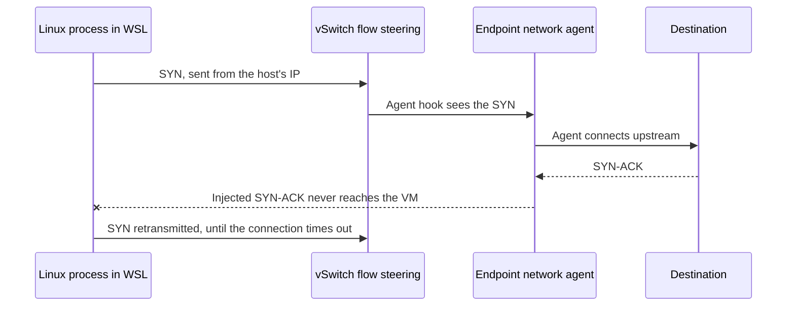

# The problem: WSL2 mirrored networking and endpoint network agents

Why Hairpin exists: how WSL2's mirrored networking mode breaks endpoint network agents such as Symantec WSS Agent, and why neither networking mode works on its own. It's for engineers and reviewers who need the background before changing the relay.

## Contents

1. [Background](#background)
1. [What goes wrong](#what-goes-wrong)
1. [Why it happens](#why-it-happens)
1. [Symptoms](#symptoms)
1. [The bind](#the-bind)
1. [Mirrored mode must really be on](#mirrored-mode-must-really-be-on)
1. [Alternatives that don't work](#alternatives-that-dont-work)
1. [How the relay helps](#how-the-relay-helps)
1. [Scope](#scope)
1. [Sources](#sources)

## Background

WSL2 has two main networking modes:

| Mode | How WSL traffic leaves the machine |
| --- | --- |
| NAT (the default) | The VM sits behind a virtual switch. Windows translates (NATs) its traffic before it leaves the host. |
| Mirrored | Windows' network interfaces are mirrored into the VM. WSL shares the host's addresses, routes and port space. |

Microsoft recommends mirrored mode, mainly because it handles VPNs better. It also adds IPv6, multicast and `127.0.0.1` access between WSL and Windows. Only IPv4 `127.0.0.1` crosses between them: `::1` isn't supported. In corporate environments, mirrored mode is often the only way to reach internal endpoints over a VPN reliably.

Many corporate machines also run an endpoint network agent, such as a secure web gateway, zero trust network access (ZTNA) or data loss prevention (DLP) client. Symantec WSS Agent is one. These agents load drivers that hook the Windows network stack and redirect outbound connections, usually into a tunnel to a cloud inspection service.

## What goes wrong

Broadcom KB 408783 describes the failure with Symantec WSS Agent in mirrored mode:

1. A process in WSL sends a TCP `SYN`.
1. The agent intercepts it and connects upstream. The upstream server replies with `SYN-ACK`.
1. The agent tries to deliver the `SYN-ACK` to WSL, but it never arrives.
1. WSL keeps resending its `SYN`, and the agent keeps resending the `SYN-ACK`.
1. The connection times out.

Broadcom says the cause is "a limitation from the OS side because its limited hooking ability", and its only resolution is to switch WSL back to NAT mode. The KB names no affected agent, Windows or WSL versions.

## Why it happens

Mirrored mode is built on Hyper-V flow steering. Linux sends traffic from the host's own IP address, with its source ports rewritten into a block the host reserves for the guest. Return traffic reaches the VM by port ownership, and that handoff happens inside the virtual switch, below the host's TCP/IP stack (verified in the WSL source and a `pktmon` trace in WSL issue 41137).

Microsoft documents the same class of problem for its own agent: "WSL traffic is forwarded below much of the GSA client hooks."

What follows is inferred, not confirmed by either vendor. A guest connection has no host socket, so the agent can only catch it at a switch or packet layer. The `SYN-ACK` the agent builds is addressed to the host IP and a guest-owned port. Injected into the host stack, it never passes the steering point that would deliver it to the VM, so it's dropped:

## Symptoms

- Outbound TCP connections from WSL hang, then time out. There's no `RST`, no "connection refused" and no proxy error page.
- DNS usually still resolves, because WSL's DNS tunnelling answers lookups through Windows in both modes. This makes the failure look like a remote-server problem.
- The same request works from Windows on the same machine at the same time.
- Traffic the agent doesn't intercept may still work, so the failure can look selective or intermittent.
- Bugs in mirrored loopback itself (WSL issues 40343 and 41102) and a Windows port with nothing listening (WSL issue 10855) also hang with no `RST`. Rule them out first.

## The bind

| | Internal or VPN endpoints | Traffic the agent intercepts |
| --- | --- | --- |
| NAT mode | Unreliable | Works |
| Mirrored mode | Works | Silently dropped |

Neither mode gives a working environment. Users must either switch modes and restart WSL depending on what they need to reach, or give up on one class of traffic.

## Mirrored mode must really be on

WSL falls back to NAT without much warning in several cases. The warning shows once, and the Settings app still says "mirrored". In NAT mode, `127.0.0.1` inside Linux is Linux's own loopback, so the relay can't be reached. Check the real mode inside WSL with `wslinfo --networking-mode`.

WSL falls back to NAT when:

- IPv6 is disabled with the registry value `HKLM\SYSTEM\CurrentControlSet\Services\Tcpip6\Parameters\DisabledComponents` set to `0xFF`. WSL reports that IPv6 "is disabled on the host in an unsupported way".
- `.wslconfig` sets `firewall=false`.
- The Linux kernel is older than 5.10, or a policy pins another mode.

So WSL can't reach the relay on a host where IPv6 is disabled with `DisabledComponents` set to `0xFF`. Mirrored mode needs IPv6, but the host doesn't have to use it. The minimal configuration that keeps mirrored mode working while using IPv6 only where it's needed, in line with the Windows 11 CIS benchmark's aim:

1. Set `DisabledComponents` to `0x20`: IPv6 stays enabled, and Windows prefers IPv4.
1. Unbind IPv6 from each network adapter with `Disable-NetAdapterBinding -Name <adapter> -ComponentID ms_tcpip6`. The WSL source notes that disabling IPv6 this way is supported.
1. Reboot. Every change to `DisabledComponents` needs one.

## Alternatives that don't work

- **NAT mode** fixes intercepted traffic but breaks VPN and internal endpoints, which is the bind above.
- **Consomme mode** (`networkingMode=consomme`, called `virtioproxy` on WSL 2.x) turns Linux frames into host sockets, so in theory the agent should see them. No agent vendor documents it as a fix: Broadcom's only resolution is NAT mode.
- **Pointing WSL clients at the agent's explicit proxy** (`ep.threatpulse.net:80`) can't work either (inferred, untested): Broadcom says that host is only reachable inside the agent's tunnel, and WSL's own connections are the ones the agent can't handle.

## How the relay helps

WSL can still reach Windows on `127.0.0.1` in mirrored mode. Hairpin listens there as an HTTP proxy and makes each connection from a Windows process, so the agent handles it like any other Windows app. See the [README](../README.md) for how it's built.

- **Without an upstream proxy**, the relay connects to each destination directly from Windows, and the agent intercepts it there. Try this first: an upstream proxy may not be needed at all.
- **With an upstream proxy**, such as `ep.threatpulse.net:80`, requests go to it unless the bypass list matches. Broadcom says nothing sent to `ep.threatpulse.net` can be bypassed, so internal and VPN hosts must be in the relay's bypass list.

The relay only carries traffic from clients that use an HTTP proxy. UDP, ICMP and raw TCP, such as SSH on port 22 without a `ProxyCommand`, still take the broken path.

## Scope

- Documented by Broadcom for Symantec WSS Agent (Cloud SWG). Not documented for Broadcom's newer Endpoint Security Agent, the only Broadcom agent on ARM64. Microsoft documents a similar failure for Global Secure Access.
- Affects TCP traffic from WSL2 in mirrored mode that the agent intercepts.
- Traffic that starts on Windows itself is unaffected.

## Sources

- Broadcom KB 408783, *WSL2 outbound connections with WSS Agent don't work when set to Mirrored mode*: https://knowledge.broadcom.com/external/article/408783/wsl2-outbound-connections-with-wss-agent.html
- Broadcom KB 278865, *Cloud SWG agent and proxy auto-configuration*: https://knowledge.broadcom.com/external/article/278865/cloud-swg-agent-and-proxy-autoconfigurat.html
- Microsoft, *Accessing network applications with WSL*: https://learn.microsoft.com/en-us/windows/wsl/networking
- Microsoft, *Troubleshooting WSL*: https://learn.microsoft.com/en-us/windows/wsl/troubleshooting
- Microsoft, *Configure IPv6 in Windows*: https://learn.microsoft.com/en-us/troubleshoot/windows-server/networking/configure-ipv6-in-windows
- WSL source, mirrored networking and the `DisabledComponents` check (`src/windows/service/exe/WslCoreVm.cpp`, `WslCoreGuestNetworkService.cpp`): https://github.com/microsoft/WSL
- WSL issues 10855, 40343, 41102 and 41137: https://github.com/microsoft/WSL/issues
