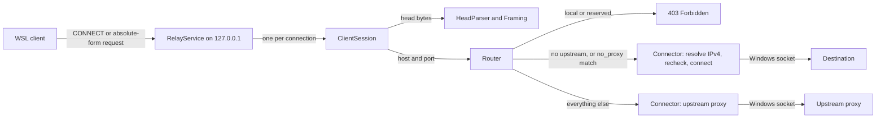

# Relay engine

How the proxy engine in [WSLProxy.Relay/](../WSLProxy.Relay/) works: what it accepts, how it routes, how it frames messages, and the limits and security rules it enforces. It's for engineers changing the engine. Read [problem.md](problem.md) first for why it exists.

## Contents

1. [Overview](#overview)
1. [Accepting requests](#accepting-requests)
1. [Routing](#routing)
1. [Plain HTTP and keep-alive](#plain-http-and-keep-alive)
1. [CONNECT tunnels](#connect-tunnels)
1. [Limits and timeouts](#limits-and-timeouts)
1. [Lifecycle, settings and status](#lifecycle-settings-and-status)
1. [Security](#security)
1. [Shared machines](#shared-machines)
1. [Decisions](#decisions)
1. [Known limits](#known-limits)

## Overview

The engine is an HTTP/1.1 forward proxy on `127.0.0.1`, IPv4 only, written on `System.Net.Sockets` with no third-party code. Each connection it makes leaves from this Windows process, so the endpoint network agent handles it.

| Folder | Holds |
| --- | --- |
| `Configuration/` | `RelayOptions`, bound from the `Relay` section, and its validator |
| `Http/` | `HeadParser`, `Framing`, `HeadWriter` and `HttpReader`: pure parsing and framing, plus the buffered reader |
| `Routing/` | `HostNormaliser`, `NoProxyRule`, `NoProxyList`, `DestinationPolicy` and `Router`: pure and thread-safe |
| `Proxy/` | `RelayService`, `ClientSession`, `Connector`, `Tunnel` and the log messages |
| `Status/` | `IRelayStatus`, `IRelayControl` and `RelaySnapshot`, the surface the UI uses |

## Accepting requests

`HeadParser` accepts only two request forms. Everything else gets an error response and the connection closes:

- `CONNECT host:port` (authority form), HTTP/1.0 or 1.1.
- `METHOD http://host[:port]/path?query HTTP/1.1` (absolute form).

Origin form (`GET /`), asterisk form, `https://` targets, userinfo, fragments and IPv6 literals are rejected with 400, which stops a browser page using the relay as a web server. TRACE gets 405 and HTTP/1.0 plain requests get 505.

Heads are parsed as bytes with strict RFC 9110 and 9112 rules: CRLF line endings only in requests, no whitespace before a field's colon, no obsolete line folding, no control characters, at most one `Host`, and no `Connection` field that names `Content-Length`, `Transfer-Encoding` or `Host`. Responses may use bare LF, because the relay writes every head again with CRLF.

## Routing

`HostNormaliser` converts the host to lowercase ASCII (international names to punycode) and strips one trailing dot. A host whose last label is numeric must be a strict dotted quad, so `127.1`, `2130706433` and `0x7f.0.0.1` are rejected rather than reaching Windows' resolver, which would read them as addresses.

`Router.Decide` then picks one route:

1. **Deny** when `DestinationPolicy` refuses the host: `localhost` names, loopback, link-local (including cloud metadata), `0.0.0.0/8`, multicast, broadcast and `168.63.129.16`. With `DenyLocalDestinations` off, only the relay's own listener is still refused.
1. **Direct** when no upstream is configured, or the bypass list matches.
1. **Upstream** otherwise.

The bypass grammar is documented on `NoProxyRule`. Names never match addresses and nothing is looked up in DNS to decide. On the direct path, `Connector` resolves the name once (IPv4 only, with the Windows resolver), drops every address the deny list refuses, and connects only to the addresses it checked, so a name can't rebind to a local address between the check and the connect.

## Plain HTTP and keep-alive

`ClientSession` serves a keep-alive loop of requests on one client connection:

1. Read and parse the head, normalise the host and decide the route.
1. Reuse the session's server connection if it has the same route and still looks open, otherwise open a new one. Server connections are never shared between client connections.
1. Send the head from `HeadWriter.BuildRequest`: origin form when direct, absolute form to an upstream, `Host` regenerated from the target, hop-by-hop fields removed, `Via` added.
1. Copy the request body while reading the response. `1xx` responses are passed on; a `101` is refused, because `Upgrade` is stripped.
1. Send the final head and copy the body with the framing `Framing.TryGetResponseFraming` chose.

The client connection closes after the exchange when either side asked for it, the response was close-delimited, or the server answered before the request body finished. If a reused server connection turns out to be closed before any response byte, the request is retried once on a new connection, but only when it's idempotent (GET, HEAD, OPTIONS, PUT or DELETE) and has no body. A timeout or a bad response is never retried, because the server may already have acted (RFC 9110 section 9.2.2).

A server connection is reused only under the settings it was opened with, so a changed upstream or deny list applies to the very next request.

`HttpReader` copies bodies exactly as framed, so bytes of a pipelined request never leak into the previous body. Chunked bodies are copied byte for byte, but every size line, the CRLF after each chunk and every trailer line are checked.

## CONNECT tunnels

- **Direct:** connect, reply `200 Connection established`, then tunnel.
- **Upstream:** send `CONNECT` to the upstream proxy and wait for its answer before forwarding any early client bytes. A `2xx` starts the tunnel; anything else, such as `407`, is passed back to the client and the connection closes.

`Tunnel` copies both ways. When one side finishes sending, the other side's socket is shut down for sending, and the other direction gets 30 seconds to drain. A watchdog closes tunnels that carry no bytes for `TunnelIdleTimeoutSeconds`.

## Limits and timeouts

Every limit is in `RelayLimits` and set in `appsettings.json`. Header and connect timeouts can be at most 3600 seconds, and the other timeouts at most 86400.

| Setting | Default | Over the limit |
| --- | --- | --- |
| `MaxRequestLineBytes` | 8 KiB | 414 |
| `MaxHeaderBytes` | 32 KiB | 431 (502 for a response) |
| `MaxHeaderCount` | 100 | 431 (502 for a response) |
| `HeaderTimeoutSeconds` | 15 | The first head must arrive in time, or the connection closes |
| `ConnectTimeoutSeconds` | 10 | 504 |
| `IdleTimeoutSeconds` | 120 | Between requests, and while a response stalls |
| `TunnelIdleTimeoutSeconds` | 900 | The tunnel closes |
| `MaxConnections` | 512 | 503 |

TCP keep-alive isn't turned on for client sockets: it breaks WSL mirrored-mode loopback connections (WSL issue 10741).

## Lifecycle, settings and status

`RelayService` binds `127.0.0.1:ListenPort` with `ExclusiveAddressUse` set before `Bind`. If the port is taken, it reports why and retries every 15 seconds. In mirrored mode, a Linux process can hold the same port.

It validates every version of the settings itself. Invalid settings never stop a running relay: it keeps listening with the last good settings and reports the problem in `RelaySnapshot.LastError`. If the settings are invalid at start-up, it stays Faulted until they're fixed. Settings aren't validated through the options system, because a failure there during a file reload would be thrown on the file watcher's thread.

A change to the port rebinds the listener. Other changes apply to the next request, even on a kept-alive connection. Pausing closes the listener, and open connections finish. With an upstream configured, a TCP probe every `HealthCheckIntervalSeconds` sets `UpstreamHealth`. Status changes are published at most four times a second. Traffic totals (requests by route, the relay's own errors, and body and tunnel bytes each way) are kept separately in `TrafficCounters`, updated as bytes are written, and read with `IRelayMetrics.Read()` rather than published, so traffic never floods the status events.

## Security

- Listens on `127.0.0.1` only, never a wildcard address, with the port held exclusively.
- Error bodies are fixed text written by the relay, never request data.
- Logs carry the method, `host:port`, route, status, byte counts and duration. Never a path, query, header, body or credential. Exceptions from connections are logged by kind only.
- `Proxy-Authorization` is never forwarded. The relay holds no credentials.
- A request that already carries the relay's own `Via` value is refused, and an upstream that resolves to the relay's own port is refused, so the relay can't loop through itself.

## Shared machines

The relay is for machines with one signed-in user. Don't run it on Remote Desktop Session Hosts, jump boxes, shared lab PCs or any machine where other people sign in at the same time.

- **Loopback is shared.** `127.0.0.1` belongs to the whole machine, not to one Windows session. Any process in any session, including another user's WSL in mirrored mode or a service, can connect to the relay. It has no proxy authentication, so it can't tell who's asking.
- **Their traffic leaves as yours.** Every connection the relay makes comes from its own process, in your session. Endpoint network agents such as WSS Agent identify users by their Windows sign-in, so they attribute the traffic to you (inferred: not tested with two users signed in), and another user's requests are filtered by your policy and logged against your name. If your policy is more permissive than theirs, they get round their own.
- **The port can be taken silently.** The relay holds its port exclusively, so a second user's relay can't bind the same port and reports the error. But that user's WSL clients, still set to `127.0.0.1:3128`, reach the first user's relay instead, with nothing to show it.
- **Why the relay can't check.** Windows can name the process that owns a loopback connection, but in mirrored mode a connection from WSL doesn't map reliably to the Linux process or the user behind it, so the relay can't filter clients by user.

The local deny list still stops anyone from using the relay to reach services on `127.0.0.1` or link-local addresses as you.

## Decisions

- **Hand-written proxy, not Kestrel or YARP.** Neither supports HTTP/1.1 CONNECT tunnelling as a forward proxy, and both would add dependencies.
- **Full keep-alive, not one request per connection.** It needs response framing, but it saves a TCP connection per request for apt and similar clients, and WSL has a limited block of ports per guest.
- **IPv4 only.** WSL can't reach Windows on `::1` in mirrored mode, and the target networks don't use IPv6.
- **Refuse local destinations.** WSL already reaches Windows' `127.0.0.1` directly, so relaying to it only adds the risk of other users or browser pages using the relay to reach local services.

## Known limits

- No `Upgrade`, so plain `ws://` websockets don't work. `wss://` works, because it uses CONNECT.
- No proxy authentication.
- Any process on the machine can use the relay, including other signed-in users, and their traffic leaves as yours. The relay is for single-user machines: see [Shared machines](#shared-machines).
- The local deny list applies to direct routes. On the upstream route the upstream proxy resolves names, so a name that resolves to a local address is the upstream's to refuse. This matters only for an upstream on the same machine.
- HTTP/1.0 is accepted only for CONNECT.
