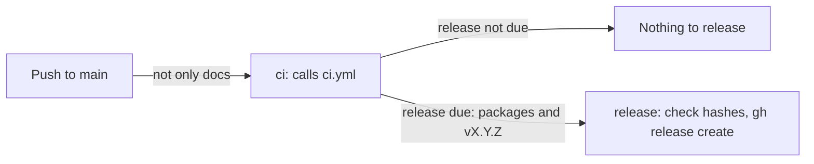

# Releases

How [`.github/workflows/release.yml`](../.github/workflows/release.yml) releases WSL Proxy Relay from `main`: when a release is made, how its version is worked out, what it publishes and the tag it creates. It also covers the signed MSIX bundle that `build.ps1 -Msix` builds from source, which releases don't include. It's for engineers changing the workflow, [`GitVersion.yaml`](../GitVersion.yaml) or the MSIX build.

## Contents

1. [Overview](#overview)
1. [How the version is decided](#how-the-version-is-decided)
1. [Tags and releases](#tags-and-releases)
1. [MSIX bundles built from source](#msix-bundles-built-from-source)
1. [Security](#security)
1. [Decisions](#decisions)
1. [Limits](#limits)
1. [Sources](#sources)

## Overview

The workflow runs on every push to `main` that changes more than the docs or agent settings: its `paths-ignore` filter skips root Markdown files, `Docs/`, `.claude/`, `.vscode/`, `.github/dependabot.yml` and `LICENSE`. CI's `changes` job skips the build of a PR for the same paths, so change both together. This flowchart shows the jobs:



- **`ci`** calls [`ci.yml`](../.github/workflows/ci.yml), so a push straight to `main` is checked as a PR is, and a failed build or test releases nothing. Its build job uploads the packages and outputs the version and whether a release is due. CI's code review runs only on a PR, so it's skipped here.
- **`release`** runs only when a release is due. It checks it's the newest run of the workflow with `gh run list`, downloads the `packages` artifact, checks every zip against `SHA256SUMS.txt`, and runs `gh release create`.

Runs share the `release` concurrency group: a run waits for the one in progress, and a newer push replaces a run that's still waiting, so two releases never race.

## How the version is decided

`build.ps1` runs [GitVersion](https://gitversion.net/) with [`GitVersion.yaml`](../GitVersion.yaml) and writes its variables to `Artifacts/version.json`. GitVersion reads every line of the commits since the latest `v` tag, which are the squash-merged PRs' titles and descriptions, and takes the biggest bump any line asks for:

| A line that starts with | Bump |
| --- | --- |
| Any type with `!`, or `BREAKING CHANGE:` | Major |
| `feat` | Minor |
| `fix`, `perf` or `refactor` | Patch |
| Any other type, such as `docs`, `ci`, `test` or `chore` | None |

- `!` always means a major bump, so until 1.0.0 no commit uses it: a breaking change is a `feat`, and its body explains what breaks.
- A release is due when `MajorMinorPatch` differs from `VersionSourceSemVer`, the version GitVersion counts from. A run whose commits are all of a type with no bump, such as a Dependabot `chore(deps)` update, releases nothing: the change ships with the next release.
- `main` uses `ContinuousDeployment` with `increment: None`, so the version on `main` is a plain `X.Y.Z` with no pre-release label.
- With no tags, GitVersion counts from `0.0.0`, so the first `feat` gives `0.1.0`.

## Tags and releases

- Each release is a GitHub release with a `vX.Y.Z` tag on the commit the run came from. Its assets are `WSLProxyRelay-X.Y.Z-win-x64.zip`, `WSLProxyRelay-X.Y.Z-win-arm64.zip` and `SHA256SUMS.txt`.
- The notes start with a warning that the builds aren't code-signed, followed by notes GitHub generates from the merged PRs.
- Only the workflow creates release tags. Nobody tags a release by hand.
- The `release` job only releases from the newest run, because a newer run releases the same changes. That also stops a re-run of an older run tagging an older commit.
- When the repository is public, the job also attests the zips' build provenance with [actions/attest-build-provenance](https://github.com/actions/attest-build-provenance), so users can check them with `gh attestation verify`. GitHub doesn't offer attestations for private repositories on this plan, so the step is skipped until then.

## MSIX bundles built from source

CI and the release workflow build only the unsigned zips. An organisation that wants an MSIX package, such as to deploy the app with Intune, builds one from source and signs it with its own certificate:

```powershell
./build.ps1 -Msix -CertificateThumbprint <thumbprint> -TimestampUrl <rfc3161-url>
```

Windows doesn't install an unsigned MSIX package and Intune doesn't deploy one, so `-Msix` needs both parameters, and the script fails before it builds without them. [CONTRIBUTING.md](../CONTRIBUTING.md#a-test-certificate-for-msix) says how to make a self-signed certificate for testing.

- **Tools:** the Windows SDK's `makeappx.exe` and `signtool.exe`. The script looks on the `PATH`, then in the newest Windows SDK for the machine's architecture.
- **Certificate:** found by thumbprint, with any spaces removed, in `CurrentUser\My`, then `LocalMachine\My`. `signtool` only looks in the machine's store when it's told to, so the script passes `/sm` for a certificate it found there. It must have the code signing extended key usage (`1.3.6.1.5.5.7.3.3`) and its private key. Its subject becomes the package's publisher verbatim, because `signtool` refuses to sign a package whose publisher doesn't match the certificate exactly. `-PublisherDisplayName` sets the publisher name Windows shows, and defaults to the subject's common name (CN).
- **Packing:** for each runtime, after the publish and the binary signing, the script copies the publish folder into `Artifacts/Msix/Staging/<runtime>/`, adds three PNG logos it draws from `Assets/wslproxy-logo.ico` and fills in [`Packaging/AppxManifest.xml`](../Packaging/AppxManifest.xml), escaping each value for XML. `makeappx pack` makes `Artifacts/Msix/Packages/WSLProxyRelay-<version>-<runtime>.msix`.
- **Bundling and signing:** `makeappx bundle` puts the `x64` and `arm64` packages into `Artifacts/WSLProxyRelay-<version>.msixbundle`. Only the bundle is signed, with SHA-256 and the timestamp server, and `signtool verify /pa` checks it, unless the certificate is self-signed: then the script skips the check with a warning, because it needs a trusted root, and a test certificate shouldn't be made one. Package versions have four parts, so the packages and the bundle use `Major.Minor.Patch.0`.
- **Output:** the bundle replaces the zips, and `SHA256SUMS.txt` lists only the bundle.

The package is a full-trust desktop app (`runFullTrust`, `packagedClassicApp` at medium integrity) for Windows 11 22H2 (10.0.22621) or later, the oldest Windows that supports WSL's mirrored networking. Windows adds it to the Start menu and the user uninstalls it from Settings like any other app. It starts at sign-in through a startup task rather than the `Run` key, and keeps its settings and logs in the package's `LocalState` folder. [Start at sign-in](tray-ui.md#start-at-sign-in) and [Settings files](tray-ui.md#settings-files) in tray-ui.md describe them.

App Installer lists the `runFullTrust` capability as "Uses all system resources" (observed). That doesn't mean administrator rights. `runFullTrust` is the restricted capability every desktop app packaged as MSIX declares, as opposed to a sandboxed Store app. The manifest also sets `uap10:TrustLevel="mediumIL"`, so the app runs at medium integrity as the signed-in user, with the same rights as the zip build. It never asks to elevate, and Windows keeps its install folder read-only and checks it for tampering.

To install the bundle, the machine must trust the certificate. A certificate that doesn't chain to a root the machine trusts, such as a self-signed one, has to be in `LocalMachine\TrustedPeople`, which needs an elevated session to add. Then double-click the bundle to install it with App Installer, or run `Add-AppxPackage <path-to-bundle>`. Intune deploys the bundle as a line-of-business app, and the devices must trust the certificate in the same way.

## Security

- The workflow's token can only read the repository, except in the `release` job, which has `contents: write` to create the release and its tag, `actions: read` to list the workflow's runs, and `id-token: write` and `attestations: write` for the attestation. That job has no checkout and runs no repository code.
- The `ci` job also allows `pull-requests: write` and `actions: read`, because GitHub checks a called workflow's permissions before it starts, and CI's code review asks for them. The review is skipped on a push, CI's build job still gets only `contents: read`, and no secrets are passed (see [CI](ci.md#security)).
- The release publishes exactly the packages CI built, after `sha256sum --check` confirms they match the checksums written by the same build.
- Every action is pinned to a full commit SHA, with its version in a comment. Dependabot updates them.

## Decisions

- **The build in CI, the release here.** The job that can write to the repository only publishes what CI built, so no repository code runs with that token.
- **GitVersion, not commitizen.** It runs on the Windows runner as a pinned .NET local tool, and `build.ps1` already uses it to stamp the binaries.
- **No release without a bump.** A run whose commits don't bump the version releases nothing, rather than a patch.
- **Unsigned for now.** Releases are published with SHA-256 checksums but without Authenticode signatures, until the project has a code signing certificate. `build.ps1` can still sign a local build with `-CertificateThumbprint`.
- **Zips in CI, MSIX from source.** An MSIX package has to be signed, and the project keeps no signing certificate in GitHub, so CI and releases stay with unsigned zips. `build.ps1 -Msix` lets an organisation build a bundle signed with its own certificate, with the publisher that certificate names.
- **One bundle, not one package per runtime.** A single `.msixbundle` holds the `x64` and `arm64` packages, and Windows installs the one that matches the machine.
- **Full trust, not an AppContainer.** An `appContainer` app, such as one under Win32 app isolation, would reach less, but Windows blocks loopback connections to packaged apps by default. Letting an unpackaged client, such as WSL's traffic, connect would need `CheckNetIsolation.exe LoopbackExempt -is` running the whole time, with administrator rights, and Microsoft supports that only for sideloading and debugging. Accepting connections on `127.0.0.1` is the relay's whole job.

## Limits

- The binaries aren't code-signed, so Windows Application Control (Smart App Control, App Control for Business or AppLocker) can block them, and SmartScreen warns on first run.
- The tags the workflow creates aren't signed.
- Releases are only immutable once the repository's release immutability setting is turned on.
- Releases don't include an MSIX bundle. CI never runs `build.ps1 -Msix`, so a change that breaks the MSIX build isn't caught until someone builds one.
- The MSIX logos are plain PNGs with no scale or target-size variants, so Windows scales them and may draw the taskbar icon on a plate.

## Sources

- https://gitversion.net/docs/
- https://docs.github.com/en/actions/sharing-automations/reusing-workflows
- https://cli.github.com/manual/gh_release_create
- https://docs.github.com/en/actions/security-for-github-actions/using-artifact-attestations
- https://learn.microsoft.com/en-us/windows/wsl/networking
- https://learn.microsoft.com/en-us/windows/msix/package/create-app-package-with-makeappx-tool
- https://learn.microsoft.com/en-us/windows/msix/package/sign-app-package-using-signtool
- https://learn.microsoft.com/en-us/uwp/schemas/appxpackage/uapmanifestschema/element-f-application
- https://learn.microsoft.com/en-us/uwp/schemas/appxpackage/uapmanifestschema/element-uap5-startuptask
- https://learn.microsoft.com/en-us/windows/msix/desktop/desktop-to-uwp-manual-conversion
- https://learn.microsoft.com/en-us/windows/msix/desktop/desktop-to-uwp-behind-the-scenes
- https://learn.microsoft.com/en-us/windows/apps/develop/communication/interprocess-communication
