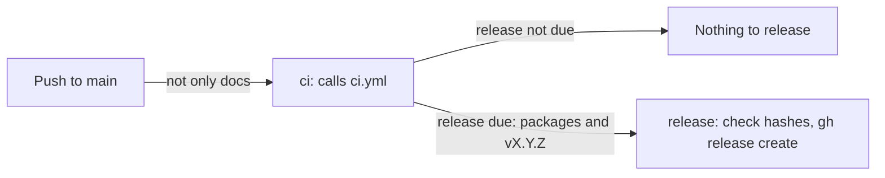

# Releases

How [`.github/workflows/release.yml`](../.github/workflows/release.yml) releases WSL Proxy Relay from `main`: when a release is made, how its version is worked out, what it publishes and the tag it creates. It's for engineers changing the workflow or [`GitVersion.yaml`](../GitVersion.yaml).

## Contents

1. [Overview](#overview)
1. [How the version is decided](#how-the-version-is-decided)
1. [Tags and releases](#tags-and-releases)
1. [Security](#security)
1. [Decisions](#decisions)
1. [Limits](#limits)
1. [Sources](#sources)

## Overview

The workflow runs on every push to `main` that changes more than the docs or agent settings: its `paths-ignore` filter skips root Markdown files, `Docs/`, `.claude/`, `.vscode/`, `.github/dependabot.yml` and `LICENSE`. This flowchart shows the jobs:

- **`ci`** calls [`ci.yml`](../.github/workflows/ci.yml), so a push straight to `main` is checked as a PR is, and a failed build or test releases nothing. Its build job uploads the packages and outputs the version and whether a release is due. CI's code review runs only on a PR, so it's skipped here.
- **`release`** runs only when a release is due. It checks it's the newest run of the workflow with `gh run list`, downloads the `packages` artifact, checks every zip against `SHA256SUMS.txt`, and runs `gh release create`.

Runs share the `release` concurrency group: a run waits for the one in progress, and a newer push replaces a run that's still waiting, so two releases never race.

## How the version is decided

`build.ps1` runs [GitVersion](https://gitversion.net/) with [`GitVersion.yaml`](../GitVersion.yaml) and writes its variables to `Artifacts/version.json`. GitVersion reads every line of the commits since the latest `v` tag, which are the squash-merged PRs' titles and descriptions, and takes the biggest bump any line asks for:

| A line that starts with | Bump |
| --- | --- |
| Any type with `!`, or `BREAKING CHANGE:` | Major |
| `feat` | Minor |
| `fix`, `perf` or `refactor` | Patch |
| Any other type, such as `docs`, `ci`, `test` or `chore` | None |

- `!` always means a major bump, so until 1.0.0 no commit uses it: a breaking change is a `feat`, and its body explains what breaks.
- A release is due when `MajorMinorPatch` differs from `VersionSourceSemVer`, the version GitVersion counts from. A run whose commits are all of a type with no bump, such as a Dependabot `chore(deps)` update, releases nothing: the change ships with the next release.
- `main` uses `ContinuousDeployment` with `increment: None`, so the version on `main` is a plain `X.Y.Z` with no pre-release label.
- With no tags, GitVersion counts from `0.0.0`, so the first `feat` gives `0.1.0`.

## Tags and releases

- Each release is a GitHub release with a `vX.Y.Z` tag on the commit the run came from. Its assets are `WSLProxyRelay-X.Y.Z-win-x64.zip`, `WSLProxyRelay-X.Y.Z-win-arm64.zip` and `SHA256SUMS.txt`.
- The notes start with a warning that the builds aren't code-signed, followed by notes GitHub generates from the merged PRs.
- Only the workflow creates release tags. Nobody tags a release by hand.
- The `release` job only releases from the newest run, because a newer run releases the same changes. That also stops a re-run of an older run tagging an older commit.
- When the repository is public, the job also attests the zips' build provenance with [actions/attest-build-provenance](https://github.com/actions/attest-build-provenance), so users can check them with `gh attestation verify`. GitHub doesn't offer attestations for private repositories on this plan, so the step is skipped until then.

## Security

- The workflow's token can only read the repository, except in the `release` job, which has `contents: write` to create the release and its tag, `actions: read` to list the workflow's runs, and `id-token: write` and `attestations: write` for the attestation. That job has no checkout and runs no repository code.
- The `ci` job also allows `pull-requests: write` and `actions: read`, because GitHub checks a called workflow's permissions before it starts, and CI's code review asks for them. The review is skipped on a push, CI's build job still gets only `contents: read`, and no secrets are passed (see [CI](ci.md#security)).
- The release publishes exactly the packages CI built, after `sha256sum --check` confirms they match the checksums written by the same build.
- Every action is pinned to a full commit SHA, with its version in a comment. Dependabot updates them.

## Decisions

- **The build in CI, the release here.** The job that can write to the repository only publishes what CI built, so no repository code runs with that token.
- **GitVersion, not commitizen.** It runs on the Windows runner as a pinned .NET local tool, and `build.ps1` already uses it to stamp the binaries.
- **No release without a bump.** A run whose commits don't bump the version releases nothing, rather than a patch.
- **Unsigned for now.** The app is a proof of concept, so releases are published with SHA-256 checksums but without Authenticode signatures. `build.ps1` can still sign a local build with `-CertificateThumbprint`.

## Limits

- The binaries aren't code-signed, so Windows Application Control (Smart App Control, App Control for Business or AppLocker) can block them, and SmartScreen warns on first run.
- The tags the workflow creates aren't signed.
- Releases are only immutable once the repository's release immutability setting is turned on.

## Sources

- https://gitversion.net/docs/
- https://docs.github.com/en/actions/sharing-automations/reusing-workflows
- https://cli.github.com/manual/gh_release_create
- https://docs.github.com/en/actions/security-for-github-actions/using-artifact-attestations
