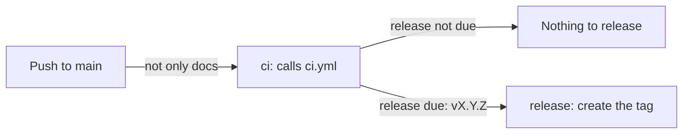

# Releases

How [`.github/workflows/release.yml`](../.github/workflows/release.yml) releases Hairpin from `main`: when a release is made, how its version is worked out and the tag it creates. A release is only a tag, and users build the app from it, so this doc also covers the builds that `build.ps1` makes, including the signed MSIX bundle that `build.ps1 -Msix` builds. It's for engineers changing the workflow, [`GitVersion.yaml`](../GitVersion.yaml) or the MSIX build.

## Contents

1. [Overview](#overview)
1. [How the version is decided](#how-the-version-is-decided)
1. [Tags and releases](#tags-and-releases)
1. [The .NET runtime](#the-net-runtime)
1. [MSIX bundles built from source](#msix-bundles-built-from-source)
1. [Security](#security)
1. [Decisions](#decisions)
1. [Limits](#limits)
1. [Sources](#sources)

## Overview

The workflow runs on every push to `main` that changes more than the docs or agent settings: its `paths-ignore` filter skips root Markdown files, `Docs/`, `.claude/`, `.vscode/`, `.github/dependabot.yml` and `LICENSE`. CI's `changes` job skips the build of a PR for the same paths, so change both together. This flowchart shows the jobs:



- **`ci`** calls [`ci.yml`](../.github/workflows/ci.yml), so a push straight to `main` is checked as a PR is, and a failed build or test releases nothing. Its build job outputs the version and whether a release is due, and uploads nothing. CI's code review runs only on a PR, so it's skipped here.
- **`release`** runs only when a release is due. It checks it's the newest run of the workflow with `gh run list`, then creates an annotated `vX.Y.Z` tag on the commit with the GitHub API. It creates no GitHub release and publishes no packages.

Runs share the `release` concurrency group: a run waits for the one in progress, and a newer push replaces a run that's still waiting, so two releases never race.

## How the version is decided

`build.ps1` runs [GitVersion](https://gitversion.net/) with [`GitVersion.yaml`](../GitVersion.yaml) and writes its variables to `Artifacts/version.json`. GitVersion reads every line of the commits since the latest `v` tag, which are the squash-merged PRs' titles and descriptions, and takes the biggest bump any line asks for:

| A line that starts with | Bump |
| --- | --- |
| Any type with `!`, or `BREAKING CHANGE:` | Major |
| `feat` | Minor |
| `fix`, `perf` or `refactor` | Patch |
| Any other type, such as `docs`, `ci`, `test` or `chore` | None |

- `!` always means a major bump, so until 1.0.0 no commit uses it: a breaking change is a `feat`, and its body explains what breaks.
- A release is due when `MajorMinorPatch` differs from `VersionSourceSemVer`, the version GitVersion counts from. A run whose commits are all of a type with no bump, such as a Dependabot `chore(deps)` update, releases nothing: the change ships with the next release.
- `main` uses `ContinuousDeployment` with `increment: None`, so the version on `main` is a plain `X.Y.Z` with no pre-release label.
- With no tags, GitVersion counts from `0.0.0`, so the first `feat` gives `0.1.0`.
- A detached HEAD, which `git clone --branch vX.Y.Z` leaves, uses the `unknown` branch config. Its `prevent-increment.when-current-commit-tagged` makes a commit with a `v` tag give exactly that tag's version, so a build from a cloned tag is stamped `X.Y.Z`. Without it, `v0.11.0` gave `0.11.1--no-branch-.1` (observed). A detached commit with no tag still gives a pre-release version.

## Tags and releases

- A release is only an annotated `vX.Y.Z` tag on the commit the run came from. The workflow creates no GitHub release, so there are no release notes and no packages. The squash-merged commits since the previous tag are the change log.
- Users build a release from source: they clone its tag with `git clone --branch vX.Y.Z` and run `build.ps1`, which makes either of the builds that [The .NET runtime](#the-net-runtime) describes. [Build a release](../CONTRIBUTING.md#build-a-release) in `CONTRIBUTING.md` has the steps.
- `build.ps1` works out the version from the Git history, so it needs a clone, not a source code archive (see [Limits](#limits)).
- Only the workflow creates release tags. Nobody tags a release by hand. The API refuses to create a tag that already exists, so a run never moves one.
- The `release` job only releases from the newest run, because a newer run releases the same changes. That also stops a re-run of an older run tagging an older commit.

## The .NET runtime

`build.ps1` makes every package in two builds, so users and IT teams can choose:

| Build | Zip | MSIX bundle | Size of a zip |
| --- | --- | --- | --- |
| Framework-dependent (recommended) | `Hairpin-X.Y.Z-<runtime>.zip` | `Hairpin-X.Y.Z.msixbundle` | Under 1 MB |
| Self-contained | `Hairpin-X.Y.Z-<runtime>-self-contained.zip` | `Hairpin-X.Y.Z-self-contained.msixbundle` | About 60 MB |

The framework-dependent build carries the app, not .NET. It runs on the .NET 10 Desktop Runtime (`Microsoft.WindowsDesktop.App`) installed on the machine, for the same architecture as the build: x64 for `win-x64`, Arm64 for `win-arm64`. Install it with `winget install Microsoft.DotNet.DesktopRuntime.10`, or from the .NET download page. Without it the app doesn't start, and .NET says which runtime it needs. The .NET SDK includes the runtime, so a machine with the SDK already has it.

The self-contained build carries its own copy of the runtime, for machines where the runtime can't be installed. Nothing patches that copy except a new build of the app, with a patched SDK, so prefer the framework-dependent build wherever the runtime can be installed.

- **Patches:** the framework-dependent build uses the newest 10.0 patch installed, so a patched runtime applies from the app's next start, without a new build of the app.
- **Microsoft Update, not Windows Update:** Microsoft ships .NET's security and other fixes through Microsoft Update. Client Windows gets them through Automatic Updates. IT teams can use WSUS or the Microsoft Update Catalog instead. Windows Server only gets them through Automatic Updates after a registry opt-in. A `BlockMU` registry value stops these updates. Windows Update itself only services .NET Framework.
- **MSIX:** an MSIX package can't declare a dependency on the .NET runtime, so App Installer and Intune install the framework-dependent bundle whether the runtime is there or not. Deploy the runtime first, such as with its own Intune app. Both bundles have the same package identity, so a machine has one or the other installed.

## MSIX bundles built from source

CI builds only the unsigned zips, and releases have no packages. An organisation that wants an MSIX package, such as to deploy the app with Intune, builds one from source and signs it with its own certificate:

```powershell
./build.ps1 -Msix -CertificateThumbprint <thumbprint> -TimestampUrl <rfc3161-url>
```

Windows doesn't install an unsigned MSIX package and Intune doesn't deploy one, so `-Msix` needs both parameters, and the script fails before it builds without them. [CONTRIBUTING.md](../CONTRIBUTING.md#a-test-certificate-for-msix) says how to make a self-signed certificate for testing.

- **Tools:** the Windows SDK's `makeappx.exe`, `makepri.exe` and `signtool.exe`. The script looks on the `PATH`, then in the newest Windows SDK for the machine's architecture.
- **Certificate:** found by thumbprint, with any spaces removed, in `CurrentUser\My`, then `LocalMachine\My`. `signtool` only looks in the machine's store when it's told to, so the script passes `/sm` for a certificate it found there. It must have the code signing extended key usage (`1.3.6.1.5.5.7.3.3`) and its private key. Its subject becomes the package's publisher verbatim, because `signtool` refuses to sign a package whose publisher doesn't match the certificate exactly. `-PublisherDisplayName` sets the publisher name Windows shows, and defaults to the subject's common name (CN).
- **Packing:** the script packs each build, framework-dependent and self-contained, on its own. For each runtime, after the publish and the binary signing, it copies the publish folder into `Artifacts/Msix/Staging/<runtime>/`, or `Staging/<runtime>-self-contained/` for the self-contained build, adds the logos and fills in [`Packaging/AppxManifest.xml`](../Packaging/AppxManifest.xml), escaping each value for XML. `makeappx pack` makes `Artifacts/Msix/Packages/<build>/Hairpin-<version>-<runtime>.msix`, with a `-self-contained` suffix for the self-contained build, where `<build>` is `framework-dependent` or `self-contained`.
- **Logos:** the script draws every logo from `Assets/hairpin-logo.svg` at its own size, so none is stretched: each of the three logos at 100%, 125%, 150%, 200% and 400% scale, and the small logo at 14 target sizes from 16 to 256 pixels, plain and unplated, which Start, search and the taskbar use. It draws only the SVG features the logo uses, and stops with an error if the SVG gains anything else. `makepri` indexes the logos into `resources.pri`, so the manifest names each logo once and Windows picks the file for the place and display scale.
- **Bundling and signing:** for each build, `makeappx bundle` puts the `x64` and `arm64` packages from `Packages/<build>/` into one bundle: `Artifacts/Hairpin-<version>.msixbundle` for the framework-dependent build and `Artifacts/Hairpin-<version>-self-contained.msixbundle` for the self-contained one. Only the bundles are signed, with SHA-256 and the timestamp server, and `signtool verify /pa` checks each, unless the certificate is self-signed: then the script skips the check with a warning, because it needs a trusted root, and a test certificate shouldn't be made one. Package versions have four parts, so the packages and the bundle use `Major.Minor.Patch.0`.
- **Output:** the two bundles replace the zips, and `SHA256SUMS.txt` lists only the bundles.

The package is a full-trust desktop app (`runFullTrust`, `packagedClassicApp` at medium integrity) for Windows 11 22H2 (10.0.22621) or later, the oldest Windows that supports WSL's mirrored networking. Windows adds it to the Start menu and the user uninstalls it from Settings like any other app. It starts at sign-in through a startup task rather than the `Run` key, and keeps its settings and logs in the package's `LocalState` folder. [Start at sign-in](tray-ui.md#start-at-sign-in) and [Settings files](tray-ui.md#settings-files) in tray-ui.md describe them.

App Installer lists the `runFullTrust` capability as "Uses all system resources" (observed). That doesn't mean administrator rights. `runFullTrust` is the restricted capability every desktop app packaged as MSIX declares, as opposed to a sandboxed Store app. The manifest also sets `uap10:TrustLevel="mediumIL"`, so the app runs at medium integrity as the signed-in user, with the same rights as the zip build. It never asks to elevate, and Windows keeps its install folder read-only and checks it for tampering.

To install the bundle, the machine must trust the certificate. A certificate that doesn't chain to a root the machine trusts, such as a self-signed one, has to be in `LocalMachine\TrustedPeople`, which needs an elevated session to add. Then double-click the bundle to install it with App Installer, or run `Add-AppxPackage <path-to-bundle>`. Intune deploys the bundle as a line-of-business app, and the devices must trust the certificate in the same way.

## Security

- The workflow's token can only read the repository, except in the `release` job, which has `contents: write` to create the tag, and `actions: read` to list the workflow's runs. That job has no checkout, runs no repository code and uses no actions, only `gh` on the runner.
- The `ci` job also allows `pull-requests: write` and `actions: read`, because GitHub checks a called workflow's permissions before it starts, and CI's code review asks for them. The review is skipped on a push, CI's build job still gets only `contents: read`, and no secrets are passed (see [CI](ci.md#security)).
- A release is a tag, with no build output, so no binary reaches users through a release. Users build from the tagged source on their own machines.

## Decisions

- **The build in CI, the release here.** The job that can write to the repository only tags a commit CI has built and tested, so no repository code runs with that token.
- **GitVersion, not commitizen.** It runs on the Windows runner as a pinned .NET local tool, and `build.ps1` already uses it to stamp the binaries.
- **No release without a bump.** A run whose commits don't bump the version releases nothing, rather than a patch.
- **Tags only, for now.** A release is a `v` tag, with no GitHub release and no packages, and users build the app themselves from the tag with `build.ps1`. A GitHub release would add only notes and a place for binaries, which the project doesn't ship. Its source code archives are the same ones the Tags page offers for every tag, and `build.ps1` can't build from them. The project has no code signing certificate, so it ships no binaries yet. `build.ps1` can still sign a local build with `-CertificateThumbprint`. This may change by 1.0.0.
- **MSIX from source.** An MSIX package has to be signed, and the project keeps no signing certificate in GitHub, so CI builds only unsigned zips. `build.ps1 -Msix` lets an organisation build a bundle signed with its own certificate, with the publisher that certificate names.
- **Both builds, framework-dependent first.** A self-contained build carries its own copy of .NET, which only a new build of the app, with a patched SDK, can patch. A framework-dependent build runs on the machine's runtime, which Microsoft Update patches as soon as Microsoft ships a fix, and IT can see and manage it like any other Microsoft product. Its cost is a prerequisite, so the self-contained build stays available for machines where the runtime can't be installed, under a name that says what it is.
- **One bundle, not one package per runtime.** A single `.msixbundle` holds the `x64` and `arm64` packages, and Windows installs the one that matches the machine.
- **Full trust, not an AppContainer.** An `appContainer` app, such as one under Win32 app isolation, would reach less, but Windows blocks loopback connections to packaged apps by default. Letting an unpackaged client, such as WSL's traffic, connect would need `CheckNetIsolation.exe LoopbackExempt -is` running the whole time, with administrator rights, and Microsoft supports that only for sideloading and debugging. Accepting connections on `127.0.0.1` is the relay's whole job.

## Limits

- A build isn't code-signed unless whoever builds it signs it with `-CertificateThumbprint`, so Windows Application Control (Smart App Control, App Control for Business or AppLocker) can block it.
- `build.ps1` needs a Git clone. In a source code archive from the Tags page, which has no Git history, GitVersion can't work out the version and the script fails (observed).
- Tags up to `v0.11.0` were made before `GitVersion.yaml` set `prevent-increment` for a detached HEAD, so a build from one of them is stamped with a pre-release version, such as `0.11.1--no-branch-.1` for `v0.11.0` (observed). The next tag is the first to build with its own version.
- The tags the workflow creates aren't signed.
- Anyone who can push to the repository can delete or move a tag, unless a tag ruleset protects `v*` tags.
- CI never runs `build.ps1 -Msix`, so a change that breaks the MSIX build isn't caught until someone builds one.

## Sources

- https://gitversion.net/docs/
- https://docs.github.com/en/actions/sharing-automations/reusing-workflows
- https://docs.github.com/en/rest/git/tags
- https://docs.github.com/en/rest/git/refs
- https://gitversion.net/docs/reference/configuration
- https://learn.microsoft.com/en-us/windows/wsl/networking
- https://learn.microsoft.com/en-us/windows/msix/package/create-app-package-with-makeappx-tool
- https://learn.microsoft.com/en-us/windows/msix/package/sign-app-package-using-signtool
- https://learn.microsoft.com/en-us/uwp/schemas/appxpackage/uapmanifestschema/element-f-application
- https://learn.microsoft.com/en-us/uwp/schemas/appxpackage/uapmanifestschema/element-uap5-startuptask
- https://learn.microsoft.com/en-us/windows/msix/desktop/desktop-to-uwp-manual-conversion
- https://learn.microsoft.com/en-us/windows/msix/desktop/desktop-to-uwp-behind-the-scenes
- https://learn.microsoft.com/en-us/windows/apps/develop/communication/interprocess-communication
- https://learn.microsoft.com/en-us/dotnet/core/install/windows
- https://learn.microsoft.com/en-us/dotnet/core/versions/selection
