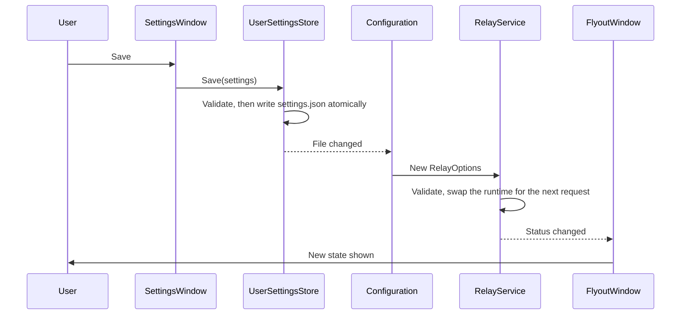

# Tray app

How the executable and the tray UI work: start-up, the notification area icon, the flyout, the settings window, settings files, start at sign-in and logging. It's for engineers changing [WSLProxy.App/](../WSLProxy.App/) or [WSLProxy.UI/](../WSLProxy.UI/). The relay itself is in [relay.md](relay.md).

## Contents

1. [Start-up](#start-up)
1. [Tray icon](#tray-icon)
1. [Flyout and settings window](#flyout-and-settings-window)
1. [Traffic metrics](#traffic-metrics)
1. [Settings checks](#settings-checks)
1. [Settings files](#settings-files)
1. [Start at sign-in](#start-at-sign-in)
1. [Logging](#logging)
1. [Decisions](#decisions)

## Start-up

`Program.Main` in `WSLProxy.App`, on an STA thread:

1. Asks Windows whether it runs from the MSIX package. `PackageIdentity.FamilyName` calls `GetCurrentPackageFamilyName` and returns null for the zip build, or on any error. The answer picks the data folder, which [Settings files](#settings-files) describes, and how the app [starts at sign-in](#start-at-sign-in).
1. Takes a mutex named `Local\WSLProxyRelay-<user SID>`. If another instance holds it, the new one exits quietly.
1. Builds a Generic Host with `Host.CreateEmptyApplicationBuilder`, so no environment variables, command-line arguments or user secrets can override settings. Configuration is `appsettings.json` from the install folder, then the user's settings file.
1. Registers the relay (`AddRelay`), the settings store, start-at-sign-in and `TrayApplication`, then starts the host, which starts `RelayService`.
1. Applies the start-at-sign-in setting. `StartupRegistration` is disabled in Debug builds and in the MSIX package, so neither touches the registry.
1. Runs `TrayApplication` until the user quits, then stops the host, giving connections five seconds to finish.

## Tray icon

`TrayIcon` calls `Shell_NotifyIcon` (version 4) directly from a hidden top-level window. A message-only window would miss the broadcasts it relies on.

- **Glyph:** `TrayGlyph.Choose` picks the light theme or dark theme `.ico` from `SystemUsesLightTheme`, which describes the taskbar, not `AppsUseLightTheme`, which describes apps. Under high contrast it contrasts with the high-contrast window colour instead.
- **Size:** the small-icon size at the taskbar's own DPI (`GetSystemMetricsForDpi` with the DPI of `Shell_TrayWnd`), loaded with `CreateIconFromResourceEx` from the exact image in the `.ico`, or the next larger one.
- **Updates:** `WM_SETTINGCHANGE` (including the `ImmersiveColorSet` theme broadcast), `WM_SYSCOLORCHANGE`, `WM_DISPLAYCHANGE` and `WM_DPICHANGED` recheck the glyph and size. `TaskbarCreated`, sent when Explorer restarts or the primary display's DPI changes, adds the icon again.
- **Badge:** when a [settings check](#settings-checks) finds a problem, `TrayBadge` draws a small red X in the glyph's lower-right corner, with a transparent gap around it, and `IconFile.FromBgra` turns the pixels into the 32-bit icon image `CreateIconFromResourceEx` reads.
- **Identity:** window handle and ID 1, not a GUID, because Windows ties a GUID to the exe's path.

## Flyout and settings window

The UI uses WPF's Fluent theme with `ThemeMode.System`, so it follows Windows' light or dark app theme and accent colour. Colours and styles come only from Fluent resources, such as `CardBackgroundFillColorDefaultBrush` and `AccentButtonStyle`, never fixed values.

- **Flyout** (`FlyoutWindow`): a left or right click on the icon opens it next to the icon. `CalculatePopupWindowPosition` places it in physical pixels, clear of the icon and inside the work area, wherever the taskbar is, then `KeepClear` moves it 12 device-independent pixels in from the work area's edges, as Windows 11's own flyouts sit clear of the taskbar. Windows leaves a taskbar set to auto-hide out of the work area, so `AvoidAutoHideBars` first takes the full thickness of any auto-hide taskbar on that monitor (`SHAppBarMessage` with `ABM_GETAUTOHIDEBAREX`) off the work area, and the flyout sits clear of it once it slides in. A flyout too tall for the gaps keeps inside the work area without them. It shows the state, the endpoint it's listening on, upstream health (one line, or one each for HTTP and HTTPS when they differ, and no row when there's no upstream proxy) and any error, then any [settings check](#settings-checks) problems and the [traffic metrics](#traffic-metrics). Its actions are Copy WSL setup, Pause or Resume, Settings and Quit. The window moves to the icon's monitor before it's measured, so per-monitor DPI is right, and it re-places itself when its height changes. A double-click opens it rather than toggling it. It hides when it loses focus or on <kbd>Esc</kbd>.
- **Log window** (`LogWindow`): the recent log lines held in memory, live, with messages wrapped to the window's width, and a lowest-level filter, a text filter, Clear, Copy and Open log folder. Copy takes the lines shown. To keep the logs, open the log folder and copy the files. See [Logging](#logging).
- **Settings window** (`SettingsWindow`): the HTTP and HTTPS upstream proxies, the bypass list, the relay port, the local deny list and start at sign-in, which Save applies (in the MSIX package, Windows manages start at sign-in, as [Start at sign-in](#start-at-sign-in) says), and a Troubleshooting section with the debug logging switch and Show logs, which act straight away. `BypassEntries` checks each bypass entry with `NoProxyRule.TryParse` as it's added, and splits a pasted `no_proxy` value into entries.

This diagram shows how saving reaches the relay:

## Traffic metrics

The flyout's Traffic card shows the speeds down and up now, in bits a second (averaged over the last 3 seconds), a chart of the last 2 minutes, the client connections open now (Conn), requests in the last minute (Req/m), the share of requests in the last 2 minutes that ended in the relay's own error (Err%: `<0.1%` for a share above 0 that would round to `0%`, and a dash when there were no requests), and totals since start, in bytes, with the share of requests that went direct. Apart from the open connections, a live count that a long CONNECT tunnel keeps up, every figure above the totals covers a recent window, so they fall back once traffic stops.

- `RelayService` keeps the totals in `TrafficCounters` and offers them through `IRelayMetrics.Read()`. They're updated as each body or tunnel write completes, so a long CONNECT tunnel counts while it runs. Message heads aren't counted.
- `TrafficMonitor` samples them once a second into a `RingBuffer` of 300 samples (5 minutes), whether the flyout is open or not, so the chart has history when it opens. That's a fixed few tens of kilobytes, however busy the relay is.
- `TrafficSummary.From` works out the rates, the error rate and the chart points from the samples, and `TrafficFormat` writes speeds in decimal units (`kb/s`, `Mb/s`, `Gb/s`), as network speeds are quoted, and sizes in binary ones, as File Explorer shows them. The flyout redraws once a second, only while it's open. Rates use `Stopwatch` time, so a clock change can't skew them.
- Errors are requests the relay answered with its own error (a refusal, a failed connection or a timeout) and responses that broke off part way. A server's own `5xx` responses aren't errors. The direct share counts only requests whose response reached the client, so each request counts once.

## Settings checks

`ConfigChecker` checks the two settings that most often stop WSL using mirrored mode, which [problem.md](problem.md#mirrored-mode-must-really-be-on) explains. Each problem shows in the flyout as a card with a one-line fix, adds the red X to the tray icon and a note to its tooltip, and is logged as a warning.

| Check | A problem when | Fix shown |
| --- | --- | --- |
| IPv6 | `HKLM\SYSTEM\CurrentControlSet\Services\Tcpip6\Parameters\DisabledComponents` is exactly `0xFF`, the only value WSL refuses mirrored mode for | Set it to `0x20` and restart Windows |
| Networking mode | The mode WSL will use isn't mirrored | Set `networkingMode=mirrored` under `[wsl2]` in `%UserProfile%\.wslconfig`, or ask IT when policy decides |

`ConfigChecks` works out the mode as WSL does (`WslCoreConfig.cpp`): `networkingMode` under `[wsl2]` or `[experimental]`, in any case, with `#` comments and the last value winning. Without it, the mode is the `DefaultNetworkingMode` policy under `HKLM\SOFTWARE\Policies\WSL`, or NAT. When `AllowNetworkingModeUserSetting` is `0`, the policy's default replaces the file's value, unless that value is `none`.

It checks at start-up, half a second after `.wslconfig` changes, and each time the flyout opens. It reads on a thread-pool thread, and anything it can't read counts as not set. It only reads what's configured: `wslinfo --networking-mode` inside WSL says what's in force, which can differ until WSL restarts.

## Settings files

| File | Holds | Who writes it |
| --- | --- | --- |
| `appsettings.json` next to the exe | Every default: relay port, upstream, limits, start at sign-in, log retention and log levels | The build. Users shouldn't edit it |
| `settings.json` in the data folder | The user's choices: port, upstream, bypass list, local deny list, start at sign-in | The settings window |

The data folder holds `settings.json`, the `logs` folder and `crash.log`. `Program.DataDirectory` picks it:

- **Zip build:** `%LOCALAPPDATA%\WSLProxy`.
- **MSIX package:** the package's own folder, `%LOCALAPPDATA%\Packages\<package family name>\LocalState`. Windows redirects new files a packaged app writes anywhere else under `%LOCALAPPDATA%` to a private location that Explorer can't see, but not this folder, so Open log folder and the paths the app shows still work. Windows deletes the folder when the user uninstalls the package.

The two builds don't share settings: a user who moves from the zip build to the package starts with the defaults. The rest of this doc writes `%LOCALAPPDATA%\WSLProxy` for the data folder.

[appsettings.schema.json](../WSLProxy.App/appsettings.schema.json) describes both files, with each setting's range and default, and `.vscode/settings.json` gives it to VS Code for completion and checks. It doesn't ship. `SettingsSchemaTests` fails when it and `appsettings.json` disagree about a key or a default, so add a new setting to both.

The user's file is layered over `appsettings.json` and reloaded when it changes. `UserSettingsStore` validates before saving, keeps any keys it doesn't own, and writes through to disk in a temporary file that it then moves into place. The default bypass list is empty on purpose, because configuration merges arrays by index. Versions up to 0.4 had one upstream proxy, under `Relay:Upstream:Host` and `Port`. Nothing reads those keys now, and saving from the settings window removes them.

A broken settings file never stops the app. At start-up, a file that isn't valid JSON is renamed `settings.json.invalid-<time>` and the defaults are used. While running, a file that can't be read or bound is ignored and the last good settings stay in force (`AddSafeOptions` never throws). Anything that still escapes is written to `%LOCALAPPDATA%\WSLProxy\crash.log`, type and stack trace only, and shown to the user.

## Start at sign-in

`StartupRegistration` writes `"<exe>" --background` to `HKCU\Software\Microsoft\Windows\CurrentVersion\Run` under the value name `WSL Proxy Relay`, which needs no admin rights.

- At start-up it registers only if the user hasn't turned the entry off in Task Manager (`...\Explorer\StartupApproved\Run`), and the entry doesn't already name another copy that still exists. The `StartupApproved` value isn't documented by Microsoft, so it's read defensively.
- When the user turns the setting on in the settings window, it registers and deletes the `StartupApproved` value, because the user has just asked for it.
- When the setting is off, it removes the Run value whichever copy it names: the value name belongs to this product.
- Registry errors are logged or shown in the settings window, never thrown.

The MSIX package works differently. Windows virtualises a packaged app's writes to the Run key, so Explorer wouldn't see them, and the install path changes with every update. So the package's manifest declares a startup task instead, which Windows turns on once the user has launched the app once.

- `Program` uses `StartupRegistration.ForPackage()`, which is disabled like a Debug build, so the app never reads or writes the Run key. `ByPackage` tells the tray it's packaged.
- The settings window hides its start-at-sign-in box and says to use Settings > Apps > Startup or Task Manager's Startup apps instead. The app can't read the startup task's state without WinRT, which the build deliberately avoids. Saving keeps the stored `StartAtLogin` value, and the package ignores it.

## Logging

Every log line goes to two places, through `Microsoft.Extensions.Logging` providers that share `LogFormat`, so they say the same thing:

- **Files:** `FileLoggerProvider` writes one file per day, `%LOCALAPPDATA%\WSLProxy\logs\relay-yyyyMMdd.log`, in UTC, from a background queue so logging never blocks the relay. It keeps `App:LogRetentionDays` days (7 by default).
- **Memory:** `MemoryLoggerProvider` adds each line to `LogStore`, which the log window shows. `LogStore` is a `RingBuffer` of `App:LogWindowLines` lines (1,000 by default, from 100 to 10,000) that drops the oldest line when it's full, and it cuts each message to 1,000 characters, so it holds about 2 MB with the default 1,000 lines and about 20 MB at the 10,000-line maximum. The log window redraws at most four times a second, and only while it's open. While its Follow new lines box is off, it holds new lines back, so the list doesn't jump while the user reads.

Exceptions are logged by type only. Request lines carry `host:port` and status, which is a browsing history of sorts: keep the retention short.

The settings window's debug logging switch turns on Debug-level lines, such as each accepted connection and each server connection opened or reused, until the app restarts. `DebugLoggingSwitch` is the last configuration source: while it's on, it sets `Logging:LogLevel:Default` and `Logging:LogLevel:WSLProxy` to `Debug` and raises a reload, so the logging filters change at once for both destinations. The reload also re-delivers the relay's options, which `RelayService` ignores when they haven't changed. It keeps its values only in memory, so debug logging is always off at start-up.

## Decisions

- **WPF with the Fluent theme**, not WinForms (which looks dated) or WinUI 3 (which needs the Windows App SDK runtime). `ThemeMode` is marked experimental (`WPF0001`); the fallback is to merge `Themes/Fluent.xaml` by hand.
- **A hand-written tray icon**, not WinForms `NotifyIcon`, which hides the window handle that `Shell_NotifyIconGetRect` needs to anchor the flyout.
- **A flyout window, not a context menu.** Native menus follow dark mode only through undocumented `uxtheme` exports.
