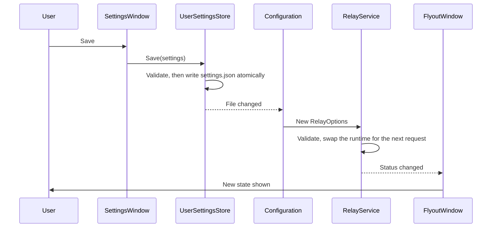

# Tray app

How the executable and the tray UI work: start-up, the notification area icon, the flyout, the settings window, settings files, start at sign-in and logging. It's for engineers changing [WSLProxy.App/](../WSLProxy.App/) or [WSLProxy.UI/](../WSLProxy.UI/). The relay itself is in [relay.md](relay.md).

## Contents

1. [Start-up](#start-up)
1. [Tray icon](#tray-icon)
1. [Flyout and settings window](#flyout-and-settings-window)
1. [Settings files](#settings-files)
1. [Start at sign-in](#start-at-sign-in)
1. [Logging](#logging)
1. [Decisions](#decisions)

## Start-up

`Program.Main` in `WSLProxy.App`, on an STA thread:

1. Takes a mutex named `Local\WSLProxyRelay-<user SID>`. If another instance holds it, the new one exits quietly.
1. Builds a Generic Host with `Host.CreateEmptyApplicationBuilder`, so no environment variables, command-line arguments or user secrets can override settings. Configuration is `appsettings.json` from the install folder, then the user's settings file.
1. Registers the relay (`AddRelay`), the settings store, start-at-sign-in and `TrayApplication`, then starts the host, which starts `RelayService`.
1. Applies the start-at-sign-in setting. `StartupRegistration` is disabled in Debug builds, so development builds never touch the registry.
1. Runs `TrayApplication` until the user quits, then stops the host, giving connections five seconds to finish.

## Tray icon

`TrayIcon` calls `Shell_NotifyIcon` (version 4) directly from a hidden top-level window. A message-only window would miss the broadcasts it relies on.

- **Glyph:** `TrayGlyph.Choose` picks the black or white `.ico` from `SystemUsesLightTheme`, which describes the taskbar, not `AppsUseLightTheme`, which describes apps. Under high contrast it contrasts with the high-contrast window colour instead.
- **Size:** the small-icon size at the taskbar's own DPI (`GetSystemMetricsForDpi` with the DPI of `Shell_TrayWnd`), loaded with `CreateIconFromResourceEx` from the exact image in the `.ico`, or the next larger one.
- **Updates:** `WM_SETTINGCHANGE` (including the `ImmersiveColorSet` theme broadcast), `WM_SYSCOLORCHANGE`, `WM_DISPLAYCHANGE` and `WM_DPICHANGED` recheck the glyph and size. `TaskbarCreated`, sent when Explorer restarts or the primary display's DPI changes, adds the icon again.
- **Identity:** window handle and ID 1, not a GUID, because Windows ties a GUID to the exe's path.

## Flyout and settings window

The UI uses WPF's Fluent theme with `ThemeMode.System`, so it follows Windows' light or dark app theme and accent colour. Colours and styles come only from Fluent resources, such as `CardBackgroundFillColorDefaultBrush` and `AccentButtonStyle`, never fixed values.

- **Flyout** (`FlyoutWindow`): a left or right click on the icon opens it next to the icon. `CalculatePopupWindowPosition` places it in physical pixels, clear of the icon and inside the work area, wherever the taskbar is. It shows the state, endpoint, upstream health, traffic and any error, with Pause or Resume, Copy WSL setup, Settings, Open logs and Quit. The window moves to the icon's monitor before it's measured, so per-monitor DPI is right, and it re-places itself when its height changes. A double-click opens it rather than toggling it. It hides when it loses focus or on <kbd>Esc</kbd>.
- **Settings window** (`SettingsWindow`): upstream host and port, the bypass list, the relay port, the local deny list and start at sign-in. Bypass entries are checked with `NoProxyRule.TryParse` as they're added, and a pasted `no_proxy` value is split into entries.

This diagram shows how saving reaches the relay:

## Settings files

| File | Holds | Who writes it |
| --- | --- | --- |
| `appsettings.json` next to the exe | Every default: relay port, upstream, limits, start at sign-in, log retention and log levels | The build. Users shouldn't edit it |
| `%LOCALAPPDATA%\WSLProxy\settings.json` | The user's choices: port, upstream, bypass list, local deny list, start at sign-in | The settings window |

The user's file is layered over `appsettings.json` and reloaded when it changes. `UserSettingsStore` validates before saving, keeps any keys it doesn't own, and writes through to disk in a temporary file that it then moves into place. The default bypass list is empty on purpose, because configuration merges arrays by index.

A broken settings file never stops the app. At start-up, a file that isn't valid JSON is renamed `settings.json.invalid-<time>` and the defaults are used. While running, a file that can't be read or bound is ignored and the last good settings stay in force (`AddSafeOptions` never throws). Anything that still escapes is written to `%LOCALAPPDATA%\WSLProxy\crash.log`, type and stack trace only, and shown to the user.

## Start at sign-in

`StartupRegistration` writes `"<exe>" --background` to `HKCU\Software\Microsoft\Windows\CurrentVersion\Run` under the value name `WSL Proxy Relay`, which needs no admin rights.

- At start-up it registers only if the user hasn't turned the entry off in Task Manager (`...\Explorer\StartupApproved\Run`), and the entry doesn't already name another copy that still exists. The `StartupApproved` value isn't documented by Microsoft, so it's read defensively.
- When the user turns the setting on in the settings window, it registers and deletes the `StartupApproved` value, because the user has just asked for it.
- When the setting is off, it removes the Run value whichever copy it names: the value name belongs to this product.
- Registry errors are logged or shown in the settings window, never thrown.

## Logging

`FileLoggerProvider` writes one file per day, `%LOCALAPPDATA%\WSLProxy\logs\relay-yyyyMMdd.log`, from a background queue so logging never blocks the relay. It keeps `App:LogRetentionDays` days (7 by default). Exceptions are logged by type only. Request lines carry `host:port` and status, which is a browsing history of sorts: keep the retention short.

## Decisions

- **WPF with the Fluent theme**, not WinForms (which looks dated) or WinUI 3 (which needs the Windows App SDK runtime). `ThemeMode` is marked experimental (`WPF0001`); the fallback is to merge `Themes/Fluent.xaml` by hand.
- **A hand-written tray icon**, not WinForms `NotifyIcon`, which hides the window handle that `Shell_NotifyIconGetRect` needs to anchor the flyout.
- **A flyout window, not a context menu.** Native menus follow dark mode only through undocumented `uxtheme` exports.
