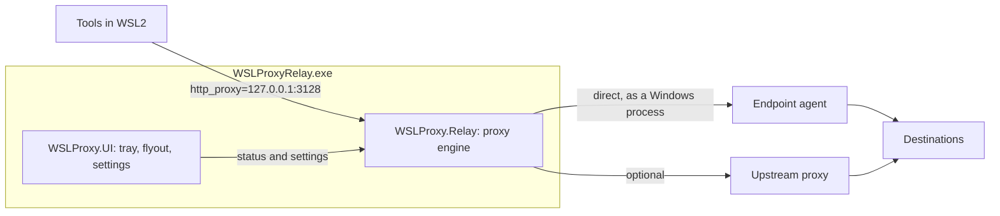

<h1 style="font-weight: 600; padding-bottom: 12px; padding-left: 10px;">
    
    WSL Proxy Relay
    
        (and systray based GUI)
    
</h1>
<em style="font-weight: 400; font-size: 14px; color: #888;">
    To make WSL network packets appear as if they are coming from the host system when you're using Mirror networking.
</em>
 
 

WSL Proxy Relay is a per-user Windows tray app that runs a local HTTP proxy on `127.0.0.1` for WSL2 in mirrored networking mode. WSL traffic sent through it leaves the machine from a Windows process, so endpoint network agents such as Symantec WSS Agent handle it again.

## Why

In mirrored mode, endpoint network agents can't deliver replies to connections that start inside WSL, so they hang. NAT mode fixes that but breaks VPN and internal endpoints. [Docs/problem.md](Docs/problem.md) explains the problem, its cause and the configuration mirrored mode needs.

## Status

Early development. Nothing has been released yet, and user docs will follow in the project's wiki.

## For engineers

WSLProxyRelay.exe is one .NET 10 process: a WPF tray UI and a hand-written HTTP forward proxy, hosted together in a Generic Host. Its only dependencies are Microsoft packages, and it runs on the .NET 10 Desktop Runtime installed on the machine, which Microsoft Update keeps patched ([Docs/releases.md](Docs/releases.md#the-net-runtime)).

- [Docs/problem.md](Docs/problem.md): the problem, its cause and the Windows configuration mirrored mode needs.
- [Docs/relay.md](Docs/relay.md): the proxy engine in `WSLProxy.Relay/`.
- [Docs/tray-ui.md](Docs/tray-ui.md): the executable and tray UI in `WSLProxy.App/` and `WSLProxy.UI/`.
- [Docs/ci.md](Docs/ci.md) and [Docs/releases.md](Docs/releases.md): how CI builds and reviews each change, and how releases are made.
- [CONTRIBUTING.md](CONTRIBUTING.md): building, testing, dependencies, versions and releases.
- The project is licensed under the [MIT License](LICENSE).
